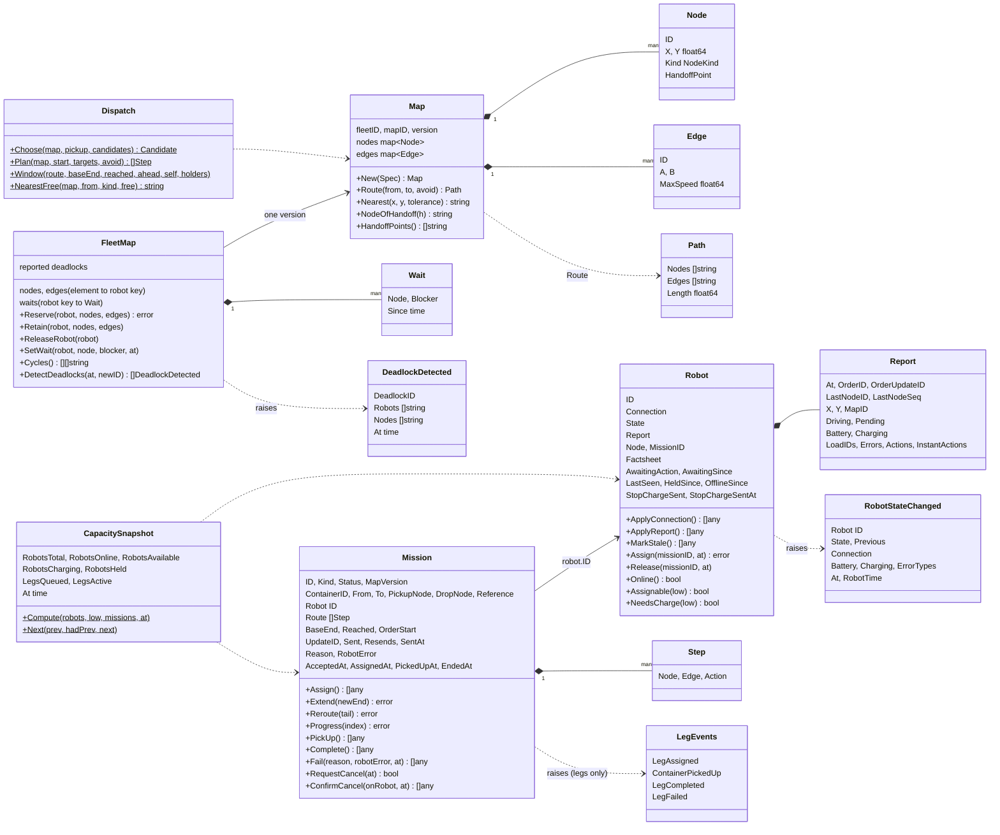
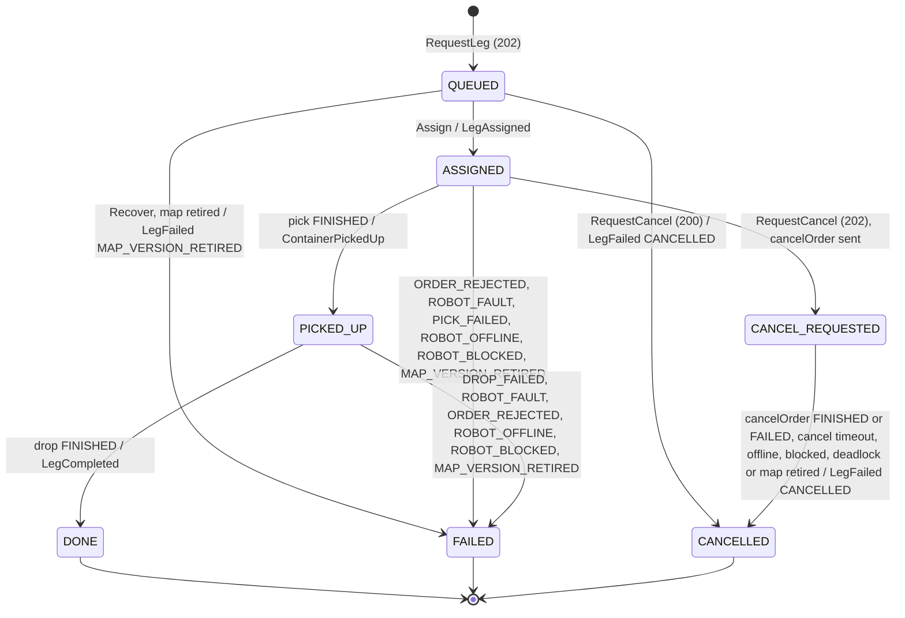
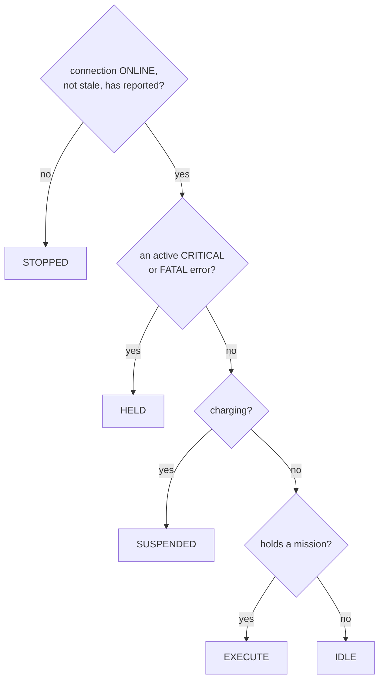

# Class diagram

The domain packages (`internal/domain/...`) import only the standard library and each other. Fields are the
persisted state structs (`fleetmap.State`, `robot.Snapshot`, `mission.State`); the aggregates keep them private.

| Enum | Values |
| --- | --- |
| `fleetmap.NodeKind` | `WAYPOINT`, `PARKING`, `CHARGER`, `PORT`, `STATION` |
| `robot.Connection` | `ONLINE`, `OFFLINE`, `CONNECTION_BROKEN` |
| `robot.State` | `IDLE`, `EXECUTE`, `SUSPENDED`, `HELD`, `STOPPED` |
| `mission.Kind` | `LEG`, `CHARGE`, `PARK` |
| `mission.Status` | `QUEUED`, `ASSIGNED`, `PICKED_UP`, `CANCEL_REQUESTED`, `DONE`, `FAILED`, `CANCELLED` |
| `mission.Reason` | `CANCELLED`, `ROBOT_BLOCKED`, `ROBOT_FAULT`, `ROBOT_OFFLINE`, `ORDER_REJECTED`, `PICK_FAILED`, `DROP_FAILED`, `MAP_VERSION_RETIRED` |

## The leg state machine

As `internal/domain/mission/transitions.go` and the use cases drive it:

`PICKED_UP` refuses a cancel (`409 leg-not-cancellable`); an ended leg refuses it with `409 leg-ended`; a second cancel
of a `CANCEL_REQUESTED` leg changes nothing (`202`). `container_on_robot` on `LegFailed` is true when the leg failed
after `PICKED_UP`, or (for a cancel) when the robot's last report lists the container as its load. CHARGE and PARK
missions start `ASSIGNED` and end `DONE` or `FAILED` without events.

## The robot state

`robot.State` is DERIVED on every connection, report or staleness change, in this priority order, and
`RobotStateChanged` is raised when the state or the connection differs from before:

A new robot starts `STOPPED` until it is `ONLINE` and has sent a `state`.
