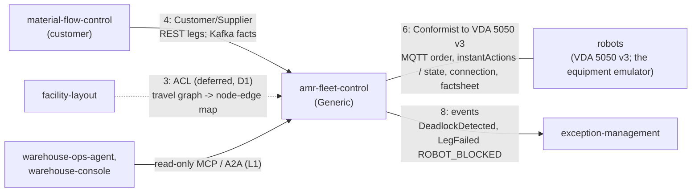

# Context Map

| # | Upstream -> downstream | Pattern | What crosses |
| --- | --- | --- | --- |
| 4 | amr-fleet-control -> material-flow-control | Customer/Supplier inside the WCS; material-flow-control is the customer, amr-fleet-control offers the subsystem-controller interface (the same shape asrs-control offers at relationship 5) | one transport leg; robot assigned; container picked up; leg completed or failed; fleet capacity |
| 6 | robots -> amr-fleet-control | Conformist to VDA 5050 v3 | `order`, `instantActions`, `state`, `connection`, `factsheet` |
| 3 | facility-layout -> amr-fleet-control | Conformist through an ACL; NOT BUILT: a map file stands in (decision D1) | waypoints, edges, stations, handoff points |
| 8 | amr-fleet-control -> exception-management | Conformist (exception-management conforms to every producer) | `DeadlockDetected`, `LegFailed` with `ROBOT_BLOCKED` |
| - | amr-fleet-control -> warehouse-ops-agent, warehouse-console | read-only consumers (not drawn on the WCS map) | MCP tools and A2A skills, authority L1 |

The one door to the WES is material-flow-control: no robot, node, edge or order ever reaches the WES.
