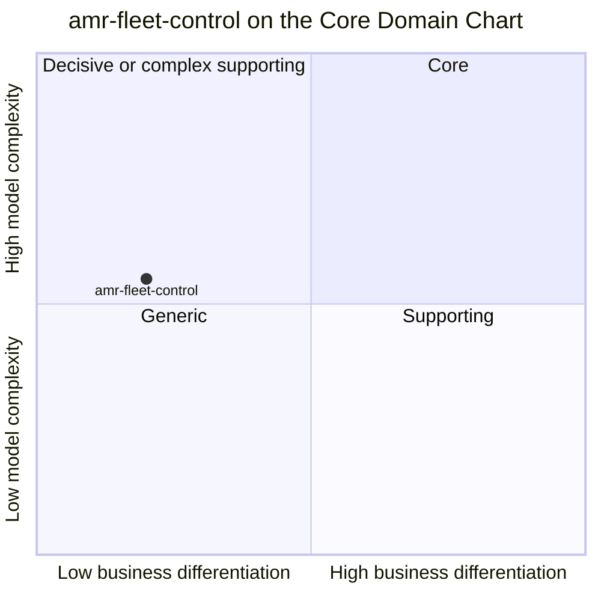

# Core Domain Chart

| Axis | Placement | Why |
| --- | --- | --- |
| Business differentiation | low | VDA 5050 standardises the job; any conforming fleet manager could do it, and the WES never sees it (no equipment vocabulary crosses the seam). |
| Model complexity | medium | Traffic control by reservation, base and horizon release, wait-for cycles and re-routing, charging and parking, a one-outcome guarantee per leg and order resends over an unreliable link: real rules, but all of them the standard's or the robots'. |

Classification: **Generic**, built on purpose under the replaceability rules
([subdomain classification](/docs/ddd/subdomain-classification)).
