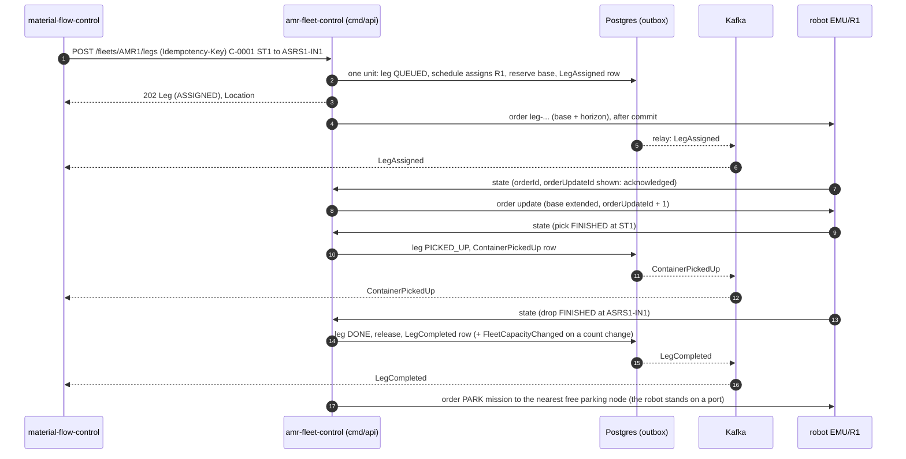

# Domain Message Flow

## A leg end to end

Each arrow into the API is one fleet unit of work; each arrow to the robot is sent from the after-commit hook of the
unit that queued it, so a rolled-back write sends nothing.

## The failure path

| Failure | Detected | Outcome |
| --- | --- | --- |
| Robot refuses the order | a rise of `VALIDATION_FAILURE` / `INVALID_ORDER` in its `state` while unacknowledged, or `ORDER_RESEND_LIMIT` resends without acknowledgement | `LegFailed` `ORDER_REJECTED`, `robot_error` = the rejection type |
| Nothing to pick / drop | the `pick` / `drop` action FAILED | `LegFailed` `PICK_FAILED` / `DROP_FAILED`, `robot_error` (e.g. `LOAD_NOT_AVAILABLE`); `cancelOrder` |
| Fatal robot error | a `FATAL` error in its `state` | `LegFailed` `ROBOT_FAULT`; `cancelOrder` |
| Blocked robot | `HELD` longer than `ROBOT_BLOCKED_TIMEOUT_SECONDS` (tick) | `LegFailed` `ROBOT_BLOCKED`, `robot_error` = the blocking error; `cancelOrder` |
| Deadlock | a wait-for cycle older than `DEADLOCK_TIMEOUT_SECONDS` (after `DeadlockDetected` and a re-route attempt) | the youngest leg `LegFailed` `ROBOT_BLOCKED`; `cancelOrder` frees its base |
| Robot gone | `STOPPED` longer than `ROBOT_OFFLINE_TIMEOUT_SECONDS` (tick) | `LegFailed` `ROBOT_OFFLINE` |
| Map retired | at boot, the leg's map version is not the loaded one | `LegFailed` `MAP_VERSION_RETIRED` |

`container_on_robot` tells material-flow-control whether the container was already on the robot (it failed after
`PICKED_UP`). amr-fleet-control never retries a failed leg with another robot (decision D4): material-flow-control
decides whether to request a new leg.
