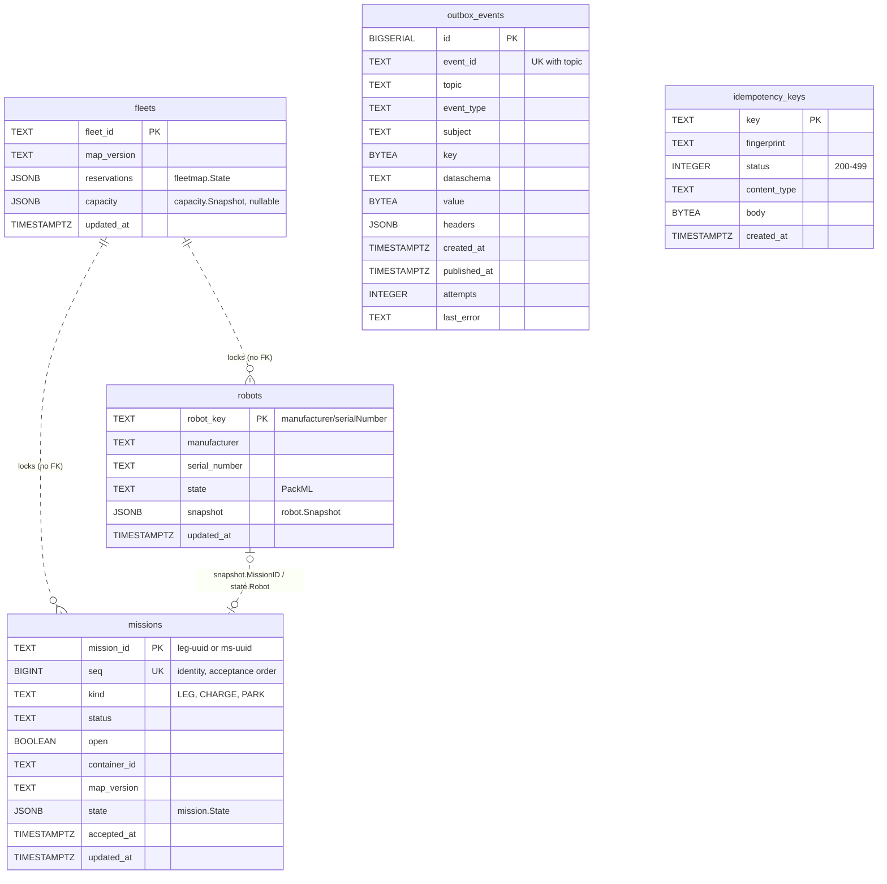

# Entity relationship

One migration, `migrations/0001_amr_fleet_control_schema.up.sql` (embedded, run at boot by every binary on
`MIGRATIONS_DATABASE_URL`). The aggregates are stored as JSONB snapshots next to the columns the queries filter on;
there are no foreign keys: robots and missions refer to each other by id inside their snapshots, and every write
holds the fleet-row lock.

| Table | Keys and indexes | Rule |
| --- | --- | --- |
| `fleets` | PK `fleet_id` | One row per fleet; every write locks it (`SELECT ... FOR UPDATE`). `reservations` of another `map_version` are dropped on load. |
| `robots` | PK `robot_key` | The registry (decision D13). |
| `missions` | PK `mission_id`; `seq` identity UNIQUE; `idx_missions_open` on `seq` WHERE `open`; UNIQUE `uq_missions_open_leg_container` on `container_id` WHERE `kind = 'LEG' AND open` | One open leg per container: the unique index is `container-busy`. `kind` CHECK `LEG`, `CHARGE`, `PARK`. Open missions load in `seq` order (acceptance order). |
| `outbox_events` | PK `id`; UNIQUE (`event_id`, `topic`); `idx_outbox_events_unpublished` on `id` WHERE `published_at IS NULL` | Two rows per event (events and analytics topic) under one `event_id`. `attempts` counts publish tries for the attempt cap. |
| `idempotency_keys` | PK `key`; `idx_idempotency_keys_created_at` | Stored POST answers (2xx and FINAL 4xx; `status` CHECK 200-499); purged hourly after 24 h. |
