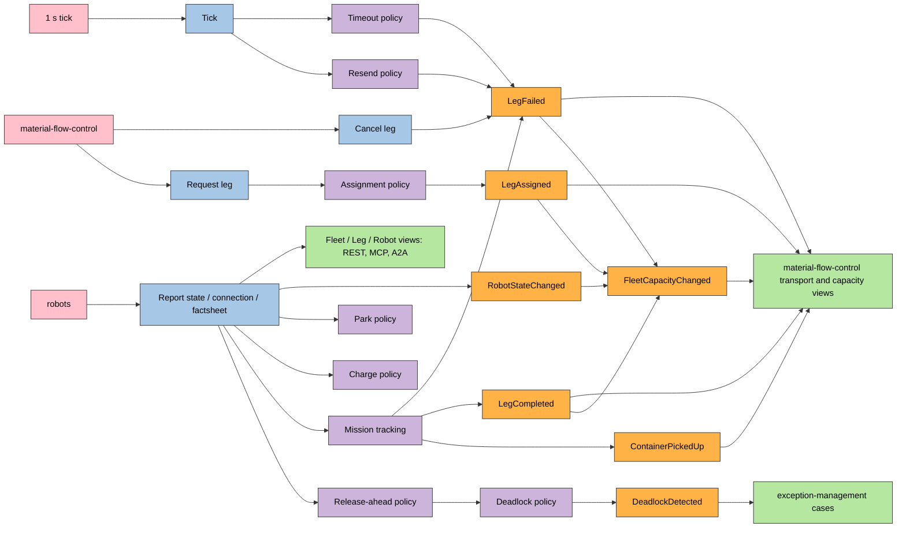

# EventStorming

Colours follow the ddd-crew legend: commands (blue), events (orange), policies (purple), read models (green), external
systems (pink).

## Commands

| Command | Actor | Use case |
| --- | --- | --- |
| Request leg | material-flow-control | `RequestLeg` |
| Cancel leg | material-flow-control | `CancelLeg` |
| Report connection, factsheet, state | a robot | `HandleConnection`, `HandleFactsheet`, `HandleState` |
| Tick | the link's worker, every second | `Tick` |
| Recover | `cmd/api` at boot | `Recover` |

## Policies

| Policy | Whenever | Then |
| --- | --- | --- |
| Assignment | a leg is queued, a robot becomes assignable | the next queued leg (acceptance order) goes to the nearest assignable robot (route length, battery, key) |
| Release-ahead | a robot acknowledged its order or reached a node | extend the base up to `RELEASE_AHEAD_NODES` past it if the stretch can be reserved, else wait at the base end |
| Mission tracking | a state shows the leg's actions | pick FINISHED -> picked up; drop FINISHED -> done; FAILED -> `PICK_FAILED` / `DROP_FAILED`; `FATAL` -> `ROBOT_FAULT` |
| Resend | an order or a `cancelOrder` / `stopCharging` stays unanswered for `ORDER_RESEND_AFTER` | send it again with the same id; after `ORDER_RESEND_LIMIT`, fail the leg `ORDER_REJECTED` (a cancel: end it `CANCELLED`) |
| Timeout | a robot is `STOPPED` / `HELD` too long | fail its leg `ROBOT_OFFLINE` / `ROBOT_BLOCKED` |
| Deadlock | a new wait-for cycle | publish `DeadlockDetected` once, re-route the youngest mission; past `DEADLOCK_TIMEOUT` fail it `ROBOT_BLOCKED` |
| Re-route | a robot waited `REROUTE_AFTER` | plan a new horizon around nodes others hold |
| Charge | an idle robot is below `CHARGE_LOW_PERCENT` | CHARGE mission to the nearest free charger; `stopCharging` at `CHARGE_RESUME_PERCENT` |
| Park | an idle robot stands on a port, station or waypoint | PARK mission to the nearest free parking node |
| Unowned order | a robot reports a pending order fleet control does not own | `cancelOrder` `recover-<uuid>` |
| Capacity | any count changed in a unit of work | `FleetCapacityChanged` |

## Read models

| Read model | Fed by |
| --- | --- |
| `GET /fleets/{fleetId}`, `/legs/{legId}`, `/robots/...`; MCP tools; A2A skills | the stored robots and missions (live capacity computed on read) |
| material-flow-control's transport and capacity views | `LegAssigned`, `ContainerPickedUp`, `LegCompleted`, `LegFailed`, `FleetCapacityChanged` |
| exception-management cases (planned) | `DeadlockDetected`, `LegFailed` `ROBOT_BLOCKED` |
