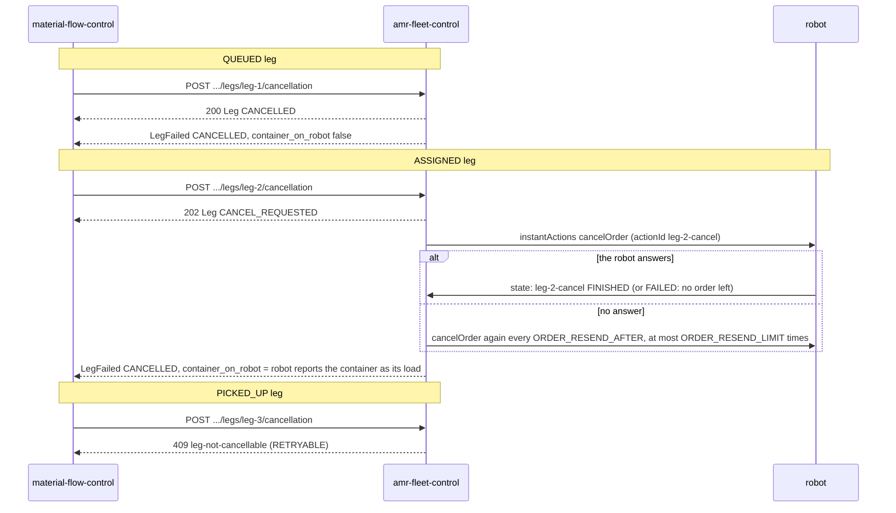
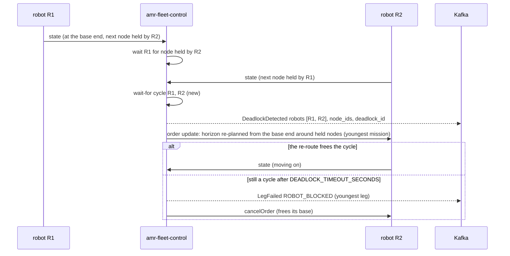
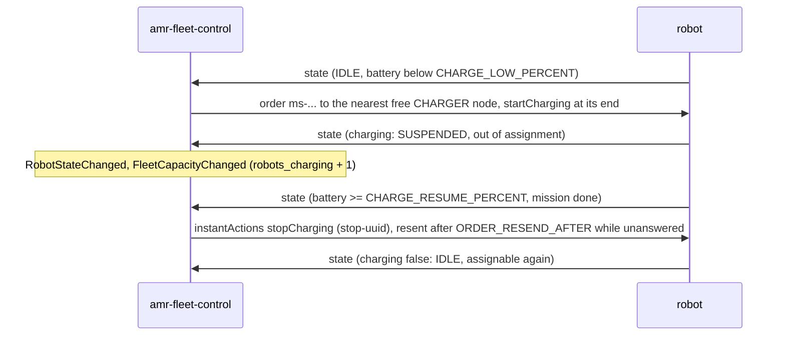
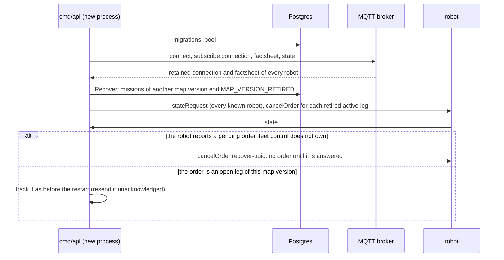

# Sequence diagrams

Every message into amr-fleet-control is one fleet unit of work; robot commands leave after its commit.

## Cancellation

## A deadlock and its re-route

## Charging

## Recovery after a restart

