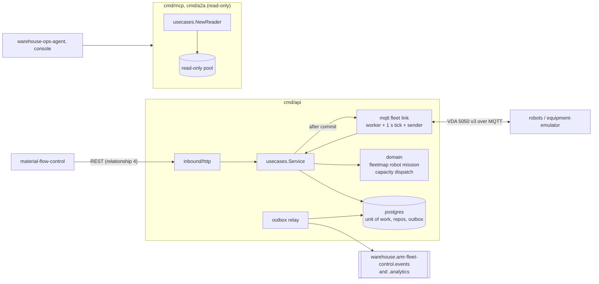

# Architecture

## Three binaries

| Binary | Port (default) | What it runs | Writes |
| --- | --- | --- | --- |
| `cmd/api` | `:8080` (`ADDR`) | the REST interface of relationship 4 and the probes, the ONE MQTT fleet link (worker, 1 s tick, ordered sender), the outbox relay to Kafka, the hourly idempotency purge | yes |
| `cmd/mcp` | `:8090` (`MCP_ADDR`) | the read-only MCP server (Streamable HTTP, stateless) on `/mcp` and `/`, `GET /healthz` | never |
| `cmd/a2a` | `:8093` (`A2A_ADDR`) | the read-only A2A agent (JSON-RPC) on `/a2a` and `/`, the card at `/.well-known/agent-card.json`, `GET /healthz` | never |

`cmd/mcp` and `cmd/a2a` wire only `usecases.NewReader` over the Postgres robots and missions, through
`postgres.NewReadOnlyPool` (every transaction `BEGIN READ ONLY`). They never dial Kafka or MQTT and never start the
relay (`internal/architecture/agent_readonly_fitness_test.go`, `agent_readonly_methods_fitness_test.go`).

## The hexagon

```
cmd/api, cmd/mcp, cmd/a2a                  composition roots (only cmd/ wires)
internal/domain/                           fleetmap, robot, mission, capacity, dispatch (standard library only)
internal/application/ports                 interfaces and sentinel errors only
internal/application/vda, idempotency,     value types (VDA 5050 commands and messages, stored answers, outbox rows,
  outbox, fleetrow                           the stored fleet row)
internal/application/usecases              one Service: RequestLeg, CancelLeg, HandleState/Connection/Factsheet,
                                             Tick, Recover, and the reads Leg, OpenLegs, Fleet, Robot
internal/adapters/inbound/http             chi REST: routes, problem catalogue, Idempotency-Key, readiness
internal/adapters/inbound/requestlog       the JSON access log
internal/adapters/inbound/mcp, a2a         the read-only agent surfaces
internal/adapters/vda5050                  VDA 5050 v3.0.0 messages (copied from the emulator) and the codec
internal/adapters/mqtt                     paho client and the fleet link: inbox, worker, tick, ordered sender
internal/adapters/outbound/postgres        pool, read-only pool, migrations, unit of work, repositories,
                                             idempotency store, outbox repository
internal/adapters/outbound/events          domain events -> CloudEvents outbox rows (both topics)
internal/adapters/outbound/outbox, kafka   the relay and its kafka-go sink
internal/adapters/outbound/telemetry       OTel Setup, slog trace context, ParseLogLevel, the leg counter
internal/adapters/outbound/memory          test doubles (no cmd/ imports them)
internal/adapters/outbound/system          wall clock and UUIDs
internal/adapters/kafka/cloudevents        the CloudEvents 1.0 envelope
internal/config                            the map YAML loader
```

`internal/architecture/architecture_test.go` (arch-go) and the fitness tests next to it enforce the rules: the domain
imports only the standard library, the application only the domain and itself, inbound and outbound adapters never
import each other, `ports` holds interfaces only, and no `cmd/` imports the memory doubles
(`runtime_no_memory_fitness_test.go`).



## One link, one worker, one order (decision D18)

There is exactly ONE MQTT client for the whole fleet, with wildcard subscriptions on `connection`, `factsheet` and
`state` (in that order, each SUBACK awaited). paho callbacks only enqueue into the link's inbox; ONE worker goroutine
handles every inbound message AND every fleet tick (`mqtt.TickEvery` = 1 s) in arrival order
(`SetOrderMatters(true)`). The whole fleet is one ordered stream, and `cmd/api` runs exactly one replica.

Outbound commands go through ONE ordered sender per link (FIFO, bounded at 1024): `headerId` is taken in the sender, so
`headerId` order is wire order, and the sender publishes only while the connection is open and paho's ordered store
holds no unsent packet (ruling P3-R10).

## The fleet unit of work

Every write (an HTTP use case, a robot message, a tick, `Recover`) runs `Service.inFleet`: one Postgres transaction
that locks the fleet row (`SELECT ... FOR UPDATE` on `fleets`), loads the reservations, every robot and every open
mission, applies the change, then saves the dirty robots and missions, the capacity snapshot, the reservations and
the events (outbox rows) before it commits. The use cases run on a `SerialUnitOfWork`: the OUTERMOST unit (the HTTP
idempotency middleware's, or the use case's own) holds one in-process lock from before its transaction until its
after-commit hooks have run, so units never interleave and commands enqueue in commit order.

## Commands only after commit

Robot commands (`order`, `instantActions`) are queued by the use case and sent from the `AfterCommit` hook of the
outermost unit of work, in the order they were queued: a rolled-back write never reaches a robot. The leg counter
`amr_fleet_control.legs.ended` is recorded in the same hook. A command the sender could not take (full queue, link
down) is logged; the tick resends an unacknowledged order, a `cancelOrder` and a `stopCharging`.
